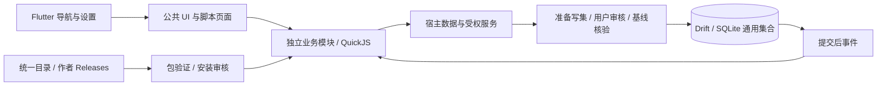

# 当前架构

生产使用 v3 模块定义、格式 2 的 ZIP 包和 Drift schema 2。宿主 API 与能力兼容范围由 [SDK](MODULE_SDK.md) 维护。使用能力见 [项目首页](../README.md)，具体协议分别由 [宿主](MODULE_HOST.md)、[SDK](MODULE_SDK.md) 和 Schema 定义。

## 产品边界

面向个人使用，目标平台为 Android 与 Windows，本地离线操作优先。默认仅保存本机数据；平台已验证范围与剩余任务以 [验证索引](VERIFICATION.md) 和 [统一待办](BACKLOG.md) 为准。

界面沿用分类设置与二级页、统一页面菜单；课表默认工作日并允许显示七天，拾光承接学校搜索、通用系统、粘贴脚本及 JSON 导入。具体行为分别由 [设置层级](features/SETTINGS_HIERARCHY.md)、[课表](features/SCHEDULE.md) 和 [拾光导入](features/SHIGUANG_IMPORT.md) 维护。

## 宿主与业务

宿主负责主题、导航、设置、安装/权限审核、通用数据与恢复；任务、视图、AI、课表和导入放在模块中。脚本不能直接调用数据库、任意 Flutter 控件或操作系统服务。界面包仅声明颜色、模板与共用控件呈现，不执行脚本。

每个脚本模块分开使用计算和交互运行时，避免等待用户操作阻塞业务计算；交互运行时由清单选择立即或首次前台使用时初始化。模块通过实例绑定的能力接口交换数据；跨模块需要精确服务权限。引擎与 App 共进程，资源/能力约束不等同于操作系统级沙箱，具体限额见宿主文档。

运行时不构建 Flutter 页面；它验证纯数据的 UI 声明身份，应用装配层通过候选校验回调检查原生页面与脚本页面的完整注册表。`AppShell` 保留导航、布局和审核对话框，HTTP、凭据、文件、浏览器及撤销生命周期由 `HostPlatformBridge` 适配。旧数据迁移和依赖资源系统的旧包转换分开，运行时只依赖数据迁移。

公共视觉基础位于 `core/ui`：主题、动效、图标不依赖组件配方渲染，App 中的旧路径保留兼容导出。页面上下文统一通过通用参数传递，旧任务／项目字段只保留构造和布局转换兼容，不隐式授予实体访问权。架构检查同时约束运行时到 UI、公共 UI 到 App 装配层的依赖方向。

## 数据与更新

业务数据保存到 `host_*` 通用集合。命令先准备不可变写入计划，宿主确认并检查记录/集合基线后事务提交；事件在提交后发出。模块更新使用不可变原包与候选数据空间，验证及迁移成功才切换活动指针，失败恢复旧版本。

原生设置通过受保护的资源适配器加入同一事务，负责设置基线验证与既有偏好表的同步写入；通用集合存储不识别具体设置集合。单包、批量、启用、更新和快照恢复共用服务兼容检查，服务 ID、主版本和声明的查询／命令类型都必须匹配。

schema 1 升级前创建 SQLite 备份；旧表、原始来源和版本留作迁移档案。停用与普通卸载保留数据，彻底删除和不兼容回退走明确审核/快照恢复流程。

宿主与业务包分别发布。模块代码变更须增加语义版本，不能覆盖同一 ID + version 或已发布 Release。客户端资源清单决定首次安装默认包，既有模块不会因更新 APK 自动升级。退出默认分发的视图由退役清单执行一次保留数据卸载，并从商店目录中过滤；已有任务与项目服务不受影响。

## 设备、AI 与分发

Android / Windows 共享 Flutter 宿主和脚本契约，浏览器采集目前仅实现 Android。AI 由设备直连模型接口，连接配置属于 AI 模块，密钥保持在系统安全存储；工具计划经过实际权限与用户审核。模块目录、作者索引和 GitHub Releases 已提供用户发起的安装/更新，签名审核市场服务端尚未建立。

Android App 的测试版与正式版共用固定证书。CI 在独立任务中签名并核对证书指纹；长期密钥由受限本机目录和 GitHub Environment Secrets 保管，签名时仅临时使用，不进入源码或安装包。App 签名与模块发布者信任是两个独立机制，保管与发布流程见 [Android 签名保管](ANDROID_SIGNING.md)。

## 实现边界检查

运行时生命周期由 `ScriptWorkerPair` 管理，集合查询执行由 `CollectionQueryEngine` 管理，时间轴几何计算与缓存由纯 Dart `PlannerBoardLayout` 管理，日编辑面板通过独立 Widget 和纯配置对象与时间轴组合，不再共享 Dart library 私有状态。规划模块提供编辑文案与时长参数。

架构检查除依赖方向外，拒绝宿主、UI、装配层和事务审核策略直接读取规划私有字段；只有旧数据迁移可识别历史字段。`time-range/2` 根据数据所属模块的已验证记录契约绑定集合、字段和历史保留规则，实际手势、完整写集及撤销基线仍由宿主校验。页面不能指定或覆盖提供者映射，提供者实例变化使旧授权失效。

`PageInvocation` 封装一次串行页面调用的读集合、预取标记和临时授权，桥接请求捕获对应调用对象。调用结束关闭原生快捷授权并释放该对象，避免进行中的桥接请求借用后续调用的临时状态；页面交互仍通过独立工作流运行时执行。
