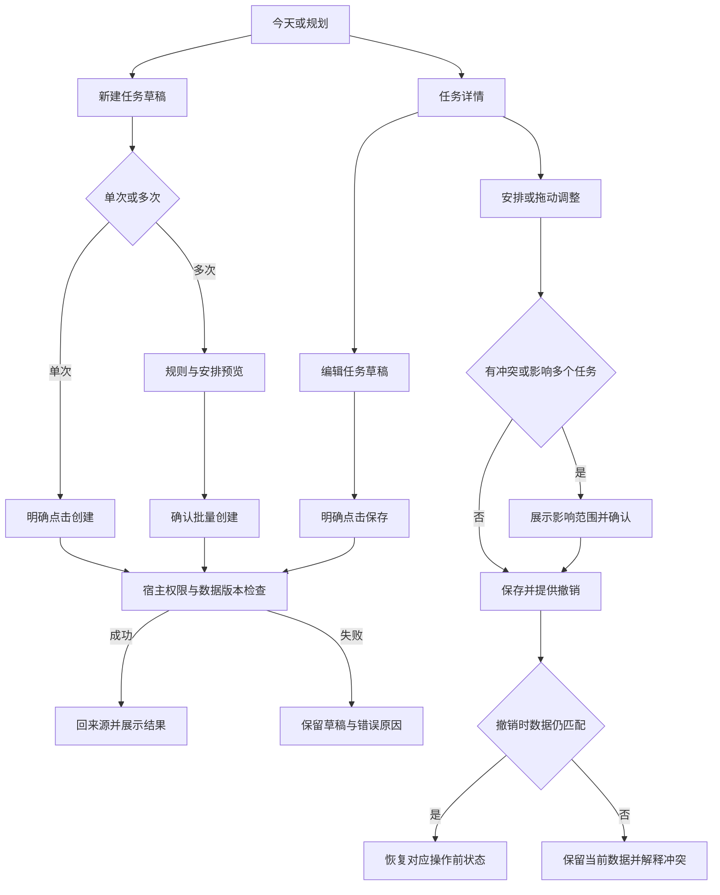
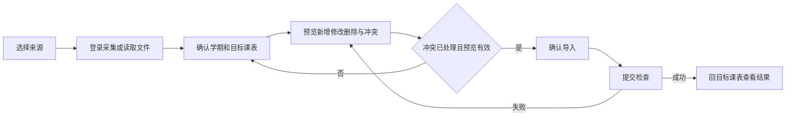
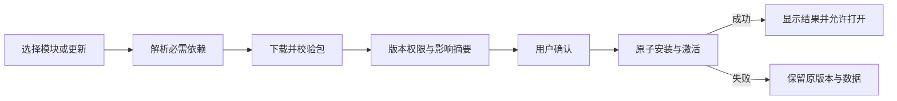

# V2 页面与交互流程

本文是独立 V2 的产品规格，输入为界面截图和文本需求，不复制旧业务 UI 代码，不要求运行旧 UI 协议或旧模块包。默认入口为 **今天、规划、课表、模块**；全部现有业务能力保留，允许合并重复页面和操作路径。

## 1. 证据与设计边界

截图清单见 [SCREENSHOT_INDEX.md](SCREENSHOT_INDEX.md)。截图只证明被捕获时的视觉状态，不证明按钮行为、保存结果、网络请求或数据迁移已通过验证。

| 证据 | 可用作参考 | 本文的新设计决定 |
| --- | --- | --- |
| S01 UI 示例、S05 更多 | 列表、标题、入口样式 | 开发示例归入模块页的开发工具，不占默认主导航；取消“更多”中转页 |
| S02 规划、S03 新建任务 | 时间轴、待安排区、渐进表单、底部主操作 | 任务与时间轴统一在规划入口；今天和规划共用任务详情与编辑流程 |
| S04 课表、S08 课程详情 | 周视图、课程块、详情表现；以索引中的实际截图为准 | 周期课程与单次课程调整明确分开，导入统一由课表确认结果 |
| S06 模块 | 已安装列表、状态、商店和外观入口 | 模块作为一级入口，更新失败保留原活动版本 |
| S07 今天、S09 任务编辑 | 日程摘要、课程和任务信息层次；以索引中的实际截图为准 | 今天负责执行与概览，复杂安排转到规划，跨入口编辑后返回原位置 |

现有功能依据为 [任务与规划](../../TASKS_AND_PLANNING.md)、[新建与持续规则](../TASK_CREATION.md)、[课表](../../SCHEDULE.md)、[教务导入](../../SHIGUANG_IMPORT.md)、[模块目录](../../MODULE_CATALOG.md) 和 [AI 助手](../../AI_ASSISTANT.md)。这些文档用于核对业务能力，不要求继承旧技术格式或旧审核交互。

拖动冲突、批量预览、导入确认、更新失败、离线及 AI 执行等状态尚不能仅凭上述截图认定已验收。本文所有 V2 流程都是待实现、待验证的目标。

## 2. 页面目录

编号用于设计、截图和验收追踪，不规定模块内部路由格式。进入页面时携带来源位置及必要实体引用；返回恢复来源日期、筛选与滚动位置。

| 编号／页面 | 入口 | 主操作与结果 | 退出／返回 |
| --- | --- | --- | --- |
| T01 今天 | 默认首页、主导航 | 浏览日期；查看课程与任务；完成或重新打开任务；新增任务 | 切换主导航保留当前日期和滚动位置；提供回到今天 |
| T02 完成记录与回顾 | T01 | 按日期查看记录，打开任务详情 | 回 T01 原位置 |
| P01 规划 | 主导航、T01 的安排入口 | 切换任务列表／时间轴；筛选任务；选择日期；安排、移动与调整时长 | 切换主导航保留视图；缩放和列数不改业务数据 |
| P02 任务详情 | T01、T02、P01、批次实例 | 查看名称、状态、描述、耗时、截止、执行时间及来源；编辑、完成、安排 | 回到实际来源；不固定跳回规划首页 |
| P03 新建／编辑任务 | T01 加号、P01 加号、P02 编辑 | 名称必填；渐进添加描述、耗时、截止、执行时间及重复规则；创建或保存 | 关闭保留草稿；显式丢弃才清除；成功后回来源并显示结果 |
| P04 内容／规则编辑 | P03 | 搜索选项、添加／移除规则；应用后更新主草稿 | 返回或关闭仅取消当前子编辑，不丢主草稿 |
| P05 模板 | P03 更多 | 查看内置／个人模板；套用、保存、删除个人模板 | 套用回 P03；替换已有非空输入前确认；删除模板不删任务 |
| P06 批量创建预览 | P03 多次任务 | 展示日期范围、可安排和未安排项、原因；调整单次安排；确认创建 | 返回编辑保留草稿；确认前不创建实例 |
| P07 批次／持续系列 | P01 更多 | 搜索及筛选系列，进入详情；查看待执行、已完成和已取消实例 | 回 P01，保留筛选 |
| P08 系列详情／规则调整 | P07 | 暂停、恢复、结束；编辑规则并预览；选择取消实例；失败补齐重试 | 回 P07；打开实例转 P02；修改规则不覆盖已手动调整的实例 |
| P09 操作历史 | P01 更多、撤销提示 | 查看实际提交结果及撤销可用性；执行撤销 | 回原页面；冲突时保持现状并可查看当前任务 |
| P10 规划设置 | P01 调整／更多 | 显示日期数、可见时段、缩放、卡片信息与拖动配置；管理手动占用和安排约束 | 视图设置可预览；涉及占用的业务改动需保存；取消恢复已保存值 |
| C01 课表 | 主导航、T01 课程入口 | 周视图、周选择、回本周、课表切换、打开课程 | 切换主导航保留课表与周次；空课表提供手动建立／导入 |
| C02 课程详情 | C01、T01 课程卡 | 查看本次日期、节次、地点、教师及周期；进入编辑课程或仅调整本次 | 回来源，恢复其日期／周次 |
| C03 课程编辑／单次调整 | C02、课程管理 | 编辑周期课程；或取消本次、改地点／节次、跨周移动、增加临时课程 | 保存后回详情；涉及整组影响先展示范围；关闭保留草稿 |
| C04 课表设置 | C01 菜单 | 管理课表、学期、周数、作息、时区、显示、课程与调课记录 | 保存后回原周视图；高级信息与常用显示设置分组 |
| C05 导入来源与采集 | C01 空状态、C04 | 学校搜索、学校入口／通用系统／脚本／JSON；登录并采集 | 返回来源保留同来源配置；换来源隔离草稿；取消不写课程 |
| C06 导入配置与预览 | C05 | 确认学期和新建／已有目标课表；查看差异、冲突、警告；确认导入 | 返回修改保留草稿；成功回目标课表；失败停在可重试步骤 |
| C07 备份与恢复 | C04 | 导出课表备份；选择备份、预览并导入 | 取消不改课表；成功后打开目标；备份不包含学校登录凭据 |
| M01 模块 | 主导航 | 已安装／发现；搜索、筛选、打开模块，查看可更新项；进入设置、外观、开发工具 | 保留搜索和筛选；不提供无页面模块的无效“打开”入口 |
| M02 模块详情 | M01 | 展示用途、版本、来源、状态、能力；安装、更新、启停、历史与恢复、卸载 | 回 M01 原位置；停用不删数据；删除数据必须单独明确确认 |
| M03 安装／更新流程 | M02、导入模块文件 | 解析依赖、下载、校验、权限及版本变化摘要、确认安装、结果 | 可取消未提交阶段；失败保留原版本；成功提供打开入口 |
| M04 应用设置／外观 | M01 | 管理导航固定项、主题、布局和恢复入口 | 预览不代替保存；取消恢复已保存外观，保留业务数据 |
| M05 开发工具／UI 示例 | M01 | 查看组件和动画演示、模块贡献、调用说明、模块源码及隔离预览 | 返回模块页；示例使用模拟数据；安装生成包仍走 M03 |
| A01 AI 对话 | M01 模块入口、用户固定快捷入口 | 发送、取消、查看历史；查询或准备业务变更 | 返回不自动重放操作；默认无独立 AI 浮动按钮 |
| A02 AI 连接与设置 | A01 设置、M01 设置入口 | 配置端点／模型／安全凭据、测试连接、工作模式、清空历史 | 保存后返回；失败保留有效连接；清空历史不撤销业务变更 |

## 3. 核心流程与提交规则

### 任务、安排和撤销

- 普通创建、编辑保存、完成／重新打开，由明确用户动作提交，不追加重复确认；宿主仍校验权限、调用身份和数据版本。模块自报“已确认”不能跳过这些检查。
- 拖动中只更新视觉预览。正常松手保存单任务调整，提交成功后提供撤销；无效落点取消，课程和固定任务不允许直接拖改。多任务影响、冲突覆盖及超截止风险先展示实际变化，再确认。
- 保存任务与安排执行时间分开。只有用户明确填写执行时间或完成安排操作才赋予计划时间；截止日期不是执行时间。
- 快捷反馈只撤销最近一次实际成功操作；更早操作从 P09 查看。后续编辑、完成状态变化或关联数据变化导致撤销不安全时，不覆盖新数据、不伪报撤销成功。
- 批量预览列出未安排项及原因，未处理必需项不能静默跳过。返回修改后旧预览失效，提交时重新检查占用与数据版本。
- 持续系列保留暂停、恢复、结束、补齐失败重试，以及“仅本次／本次及以后”的调整范围。规则修改仅影响应受影响的未来实例，不悄悄重排已有手动安排。撤销批量创建同时停止相应系列继续生成。
- 模板只包含任务配置和规则，不携带任务完成状态及历史实例。重复规则保留每日／间隔、允许星期与时段、优先时间点、优先级等能力；互斥与时间冲突在预览前说明。
- 自动补齐在应用启动、恢复及可运行期间执行；产品不宣称关闭应用后可靠常驻。再次启动时补齐未来范围，保留过期未完成任务。

### 课表与导入

- 学校登录由用户在浏览器中完成；截图、业务预览和备份均不显示或携带密码、Cookie、API Key。没有真实账号验收时不宣称学校导入已经可用。
- 目标不存在时直接新建；已有课表可选择新建或合并目标。替换来源、全量删除必须展示具体影响并确认，空结果和局部结果不能自动清空课表。
- 学期第一周、周数、作息及来源数据需明确确认。无法判断第一周日期时不猜测；新课表使用设备时区，获取失败明确提示回退；已有课表保留其时区。
- 重复导入比较旧来源、本地现状与新来源。用户修改、删除过的课程发生冲突时提供保留本地或采用来源的明确选择。
- 采集取消不写课程；切换学校或来源不串用草稿。网络恢复重试不重复提交已经成功的导入。
- 课程编辑明确显示“整个周期”或“仅本次”。单次取消／调课不修改整门课程；视图周次、列数、行高改变不修改课程数据。

### 模块与 AI

- 更新由用户发起，不后台静默执行。展示“下载、校验、准备、安装”真实阶段；下载百分比不代表安装完成，缓存包也要校验。
- 安装详情将用途、依赖和新增权限放在前面，摘要等技术信息可展开。用户取消不进入安装；提交已开始时显示处理中，不能仅因关闭页面就宣称取消成功。
- 无网络时可查看已安装和缓存目录、打开已启用模块；只有依赖包已齐全并通过校验才允许离线安装。索引失败不阻断原模块使用。
- 停用保留模块数据并停止其活动请求；卸载与删除数据分开呈现，明确关联模块影响。历史恢复先检查数据兼容性，不能将任意降级描述为安全撤销。
- AI 先配置连接并测试，再进入聊天。模型查询需授权对应能力；写入必须展示实际变更并由用户确认。失败、取消或停用会停止未完成请求，但已提交业务结果保留并明确展示。
- AI 多步结果不是整体事务；部分成功时列出已完成与失败步骤。撤销只对支持且通过当前状态检查的操作提供，不伪造通用“全部撤回”。
- 高级模块生成与手动源码编辑放在开发工具中，结果须经隔离预览与正常安装审核，不能直接修改运行中的包。

## 4. 通用状态、导航与反馈

| 状态 | 展示与可用动作 | 数据与返回行为 |
| --- | --- | --- |
| loading | 保留稳定页面结构；已有内容可保留，首次加载显示占位；短加载不闪烁进度 | 不清空草稿；切页后的过期结果不得刷新新页面 |
| empty | 说明当前日期、筛选或模块为什么为空；提供对应创建、导入、安装或清除筛选 | 不用演示数据冒充用户记录；空列表不是网络失败 |
| error | 页面内说明失败步骤，提供重试及必要的重新预览 | 保留输入和已保存数据；不自动无限重试，不显示敏感服务端原文 |
| saving | 主提交按钮显示处理中并防重复点击；可浏览不相关内容 | 保存结果按真实事务返回；失败保留草稿，成功后才清理草稿及显示完成 |
| offline | 明确哪些能力受影响；本地任务和已缓存课表仍可使用 | AI、学校采集、缺包下载不可伪报成功；不默认建立稍后自动写入队列 |
| conflict | 展示数据已变化、受影响对象及需要重读／重新预览的原因 | 不静默覆盖；保留用户意图作为草稿，重新确认后才提交 |

- 默认主导航为今天、规划、课表、模块；入口由模块能力提供。未安装／停用对应能力时展示安装或启用入口，不出现空白页或无效按钮。用户可固定 AI 等快捷入口，但默认无独立 AI 浮动按钮。
- 系统返回依次处理：输入法 → 最上层弹窗／菜单 → 当前面板内子页 → 当前面板 → 当前模块页面栈 → 根页面的系统返回行为。一次返回只退一层；没有键盘时不额外消耗一次返回。
- 表单子页拥有独立草稿，应用后合并主草稿。主表单关闭保留草稿并轻量提示；重开恢复。编辑已有记录后外部版本发生变化时，恢复草稿需先显示冲突。
- 新建、编辑保存成功返回原来源与原位置；从今天进入课程编辑后返回今天，从规划进入任务编辑后返回规划。取消不改业务数据。
- 弹窗与面板必须提供可见关闭或返回入口；键盘出现时主操作可触达，正文可以滚动，底部导航不与表单主操作竞争。关闭最上层内容后恢复原焦点。
- 完成任务后在原位置展示完成状态，不突然消失；筛选确实要求隐藏完成项时，在提交成功后更新列表并保留明确反馈。
- 动画用于表达进入、返回、状态变化和拖动结果。减少动态效果时保留相同流程与结果，不依赖动画完成才能提交或退出。

## 5. 流程验收矩阵

以下为新实现的验收要求，不是旧版或 V2 已通过的结果。所有写入场景使用隔离测试数据，不修改截图所对应的用户业务记录。

| 场景 | 必须验证的结果 |
| --- | --- |
| 今天／规划共用新建与编辑 | 名称校验、渐进字段、主草稿关闭重开、子表返回取消、一次提交、防重复、回原入口 |
| 输入法与返回 | 键盘遮挡、系统返回层级、面板返回、取消和再次打开、焦点恢复 |
| 时间轴 | 拖入、移动、调整结束时间、无效落点、课程只读、跨日、缩放不改数据、导航不挡末行 |
| 撤销 | 成功撤销、已有后续修改、完成状态变化、重复撤销、历史查看、失败不覆盖新数据 |
| 批量与系列 | 无可用时间、规则冲突、预览过期、取消、暂停／恢复／结束、仅本次／以后、撤销创建不再补齐 |
| 课程与导入 | 切周、课程详情、周期编辑与单次调整、新建与合并导入、冲突、局部／空结果、取消与网络失败 |
| 模块安装更新 | 依赖缺失、离线缓存、坏签名、权限变化、下载取消、重复操作、安装失败保留原版本、更新后重开 |
| AI | 未配置、连接失败、发送取消、权限拒绝、写入拒绝、部分成功、停用中断、敏感信息不泄露 |
| 全局状态 | 首次加载、空状态、长文本与大字号、横竖布局约束、离线、错误重试、冷启动恢复已保存状态 |

验收记录应分别标明“截图观察”“交互已走通”“提交结果已核对”“尚未验证”，避免用静态截图替代完整流程证据。
